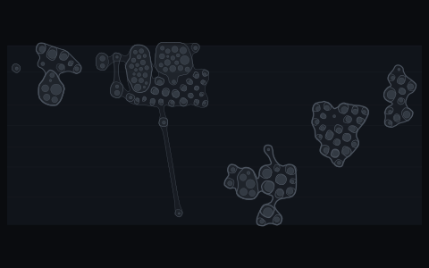

# atis

A weather map for code changes. The terrain is your repository: its modules, how deep
they sit, how big and how healthy they are. The weather is what one change does to it:
what moved, how far it ripples, what evidence covers it, and what to look at first. You
read the weather in ten seconds, then go in only where it is bad.



atis's own terrain, drawn by `atis fingerprint` ([docs/fingerprint.md](./docs/fingerprint.md)).

atis reads three sources and draws what they say. Git gives it the change and the
history. The `.check/` directory [checkride](https://github.com/robmclarty/checkride)
writes gives it the tests, coverage, mutants and checks. The repository's own
[fallow](https://docs.fallow.tools) gives it health, duplication, cycles and boundaries.
A source that is missing mutes what it would have drawn, and never stands in a number of
its own. atis informs; it never blocks.

## Install

atis needs Node 22.18 or later, and git.

```bash
npm install --global @robmclarty/atis
atis --version
```

Or run it once without installing it: `npx @robmclarty/atis`.

## Run it

Inside a repository, with no flags, atis maps this branch's change over the trunk and
opens it in a browser tab:

```bash
atis
```

It serves the world on `127.0.0.1`, at a port of its own, behind a token made for the
run, until you press Ctrl-C. `--no-open` serves without opening the tab. Run your
checkride gate (`pnpm check`) first and the map carries its evidence; without a `.check/`
the map reads `NOINST` and draws the change from git alone.

### The bases

The change is measured from a base, at the merge base of the base and the head:

| Flag | Measures from |
| --- | --- |
| none | the trunk: the branch `atis.config.json` names, else the first of `main`, `master`, `develop` and `trunk`, each tried locally and then on `origin/` |
| `--base <ref>` | any ref: a branch, a tag or a commit |
| `--last-commit` | the head's parent, `HEAD~1`, so the last commit alone |
| `--last-tag` | the newest tag the head reaches, so everything since that release |

The head is `HEAD` unless you name another:

- `--head <ref>` maps the change at another commit. `.check/` belongs to the checked-out
  `HEAD`, so another head is mapped from git alone.
- `--working-tree` maps the working tree, staged, unstaged and untracked, with `.check/`
  as its evidence. `atis --base HEAD --working-tree` is your uncommitted change alone.

### A still map, a PNG, or the data

```bash
atis --svg atis.svg      # the still map, with map.json beside it, then exit
atis --png atis.png      # the world captured headless, with map.json beside it, then exit
atis --out map.json      # the map's data alone, then exit
```

- `--svg` draws the still map: the field, the weather, the HUD and the notices of the
  world, in an SVG where nothing moves. `--open` opens it in your viewer.
- `--png` captures the world as the tab opens, the whole map lit and fitted to the
  picture, at 1280 by 800 with its motion stilled, in your installed Chrome, else a
  Chromium on the `PATH`, else the one `npx playwright-core install chromium` installs.
- `--out` writes `map.json`, the data every renderer reads. Beside `--svg` or `--png` it
  defaults to `map.json`.

### Watching

```bash
atis --watch
```

keeps serving and, whenever `HEAD`, the index or `.check/summary.json` changes, rebuilds
the map and pushes its weather to the open tab over the terrain it already shows. Commit,
or run your checks again, and the tab follows.

```bash
atis --working-tree --watch
```

follows the working tree's uncommitted edits too: an edit that stages nothing is noticed
within about a second, the map is rebuilt, and the tab follows you, or a coding agent, as
the files are written. The same holds once the strip under the HUD has switched the tab to
the working tree. A file that is written all the time and not ignored, as a dev server's
log is, keeps the watch rebuilding, and the terminal says so once; the cure is to ignore
the file.

- The status line says `live` while a watch follows the repository, and only then: a run
  with no `--watch` does not say it, and its tab stands still until you run atis again.
- A rebuild takes as long as measuring the map does. On atis's own repository, about 180
  files, an edit shows in the tab four to ten seconds after it is written, by how busy the
  machine is. The status line says `live · rebuilding` from the moment the edit is noticed
  until the map arrives.
- An edit inside files the map already holds is pushed in place, and the view, the
  selection and the open panels stay as they are. One that adds or removes a file, or
  changes what a module exports, draws the page afresh where you stood, with what you had
  selected selected again.

### Posting to a pull request

```bash
atis --comment
```

finds this branch's pull request with [`gh`](https://cli.github.com) and posts the map
there, or updates the comment it posted before: the HUD as a table, the notices with their
whys and the thresholds that fired, and the image, which it keeps on the repository's
`atis-maps` branch. It measures over the pull request's base unless `--base` names
another. Without `gh`, or with no pull request, it exits 2 and says why. It is the one
command that reaches the network, and only when you type it.

### A range of commits

```bash
atis --range v1.0.0..HEAD
```

maps the change from the first ref to the second, with one weather frame for each commit
between them, oldest first, over the one terrain. The HUD carries a scrubber with a tick
per commit in its category's colour: click it, or press `,` and `.`, to step. Only the
checked-out `HEAD`'s frame reads `.check/`.

### The whole repository

```bash
atis --whole-repo
atis --whole-repo --svg cycles.svg --overlay cycles
```

maps the repository at the head with no change: no weather, and instead overlays of where
it hurts. They are trouble spots (churn by complexity), ugly spots, coverage gaps, dead
code, duplication, cycles, recent heat, and the findings a committed
`checkride.baseline.json` grandfathers. The world toggles between them in the HUD; `--svg`
draws one, trouble spots unless `--overlay` names another. An overlay whose source is
missing says why.

### The approved shape

```bash
atis approve
atis approve --show
```

records the shape of the repository you accept: every module the head holds, with its
files, its lines, its interface and its fan out, and the outside packages it imports. It
measures the map the same flags would draw, the change over the trunk at `HEAD` with none,
and keeps that map's shape as `atis/approved.json` in the repository's git directory, in
place of the one before, so nothing lands in the working tree. `--show` prints the
approved shape as it is kept and approves nothing.

Every map built after carries its departures from the approved shape: a module added or
removed, one grown in files, lines or fan out, an interface widened or entered past, an
outside package added. The world says how many there are in its status line, lists them
in the inspector and counts them on the folder tree's rows. It is a way to keep watch on the structure of a repository someone
else is writing, a coding agent included: read the shape, approve it, and the next map
says how it has moved.

- Approve with the flags you map with: `atis approve` takes `--base`, `--last-commit`,
  `--last-tag`, `--head`, `--working-tree` and `--whole-repo` as a map does. Lines, fan out
  and an interface with no barrel are compared only by a map over the base the shape was
  approved over; a map over another base says in the terminal that they were left out.
- Growth is told past a limit: three more files, or three more of fan out, and a quarter
  more; a hundred more lines and a quarter more; one more exported name, or one more
  import past an interface, at once. So one file added to a module is no departure, and a
  new directory is. Nothing is told for a module that shrank.
- Over one base, a module's lines and its fan out are read from the base, so their growth
  is told for the files a change adds and not for the ones it only edits.
- Under `--watch`, approving rebuilds the map and pushes it to the open tab.
- There is one approved shape for a repository, shared by all its worktrees, and approving
  takes the place of the one before with no undo.

### The fingerprint

```bash
atis fingerprint --out docs/img/fingerprint.svg
```

draws the terrain alone, small, for a README, as the image above does: 480 by 300, with no
weather, no notices and no text, the same bytes for one commit.
[The fingerprint's page](./docs/fingerprint.md)
has a workflow that keeps it fresh.

### Before a change

A map reads a change that already happened. `atis reach` answers the question the other
way round: name the files you mean to change, and it says what a change there would
reach, before you make it.

```bash
atis reach src/limiter.ts src/__tests__/limiter.test.ts
atis reach --json src/lib/
```

It answers from the checked-out `HEAD` with two kinds of evidence. The files that import
the ones you named are reached by `import`, priced in module hops as the map prices its
reach, with the interfaces crossed on the way. The files that usually move with them in
history are reached by `cochange`, with the rate and the count of shared commits, held to
the thresholds a ghost is held to; a test rides here only, since a test is never a cell.
A `dir/` stands for every file under it, and a path that names nothing at `HEAD` yet is
listed as `new`, with no reach of its own.

With no `--json` it prints a short table. With it, it prints one object of kind
`atis.reach` at its own `schema_version`, sorted, the same bytes for one commit and one
set of paths:

```json
{
  "schema_version": 1,
  "kind": "atis.reach",
  "head": "9f3c2a1e…",
  "paths": ["src/limiter.ts"],
  "new": [],
  "reach": [
    { "path": "src/config.ts", "by": "cochange", "rate": 0.67, "support": 4, "with": "src/limiter.ts" },
    { "path": "src/server.ts", "by": "import", "hops": 1, "via": ["src/limiter.ts"] }
  ],
  "muted": []
}
```

`--history <n>` names the window of commits it reads, as for a map, and `--no-history`
reads none, for the import reach alone. A source that is missing mutes its half in words,
under `muted`: a shallow clone mutes the co-change half, and a file in a language atis
does not read has no import reach. Paths are read from `--repo`, the working directory
unless named, and answered from the repository's root; an absolute path, or one that
leaves the repository, is misuse. No reach is too much: `atis reach`
exits 0 once it has answered, and what counts as too far is yours to decide.

### Everything else

- `--repo <path>` reads a repository other than the working directory. Either may be any
  directory inside the repository: atis reads it from its root.
- atis keeps each base's terrain in `atis/` under the repository's git directory
  (`git rev-parse --git-common-dir`), never in the working tree, so a second run on the
  same base opens fast, from any worktree of the repository. `--no-cache` measures afresh.
  The approved shape is kept beside it, one for the repository.
- `--history <n>` reads the newest `n` commits of history, 5,000 by default.
- `--verbose` prints each source's timing, and each cache's hit or miss, on stderr.
- `atis.config.json` at the repository's root may name the `trunk`, and an `editor` URL
  template for the links that open a file at a line (`vscode://file{root}/{path}:{line}`
  by default).
- `atis --help` prints every flag.

atis exits 0 whenever it wrote or served what you asked for, whatever the weather says,
and 2 on misuse or a broken input. It never exits 1 for bad weather.

## Reading the map

The grey field is the repository at the base. Everything lit is the change. The still map,
the PNG and the world draw the same marks, and a key at the foot of the notice column
numbers them.

### The category

The coloured block at the top left is set by the change alone:

- **VFR**, green, "glance-mergeable": nothing below applies.
- **MVFR**, blue, "mergeable with a look": a changed line no test ran, or a changed module
  interface that is used from outside its module, and nothing red.
- **IFR**, red, "needs instrument review": a failing check names a changed file, or a file
  with changed lines no test ran reaches three or more modules.
- **LIFR**, magenta, "do not approach": the checks ran nothing, or a cycle or a boundary
  violation touches a changed file.
- **NOINST**, grey: there were no check results to read.

### The HUD

The blocks after the category, left to right:

- **Patch cov**: the share of the change's executable lines the tests ran, and how many
  changed files no coverage report names.
- **Mutants**: mutants that survived the tests on the changed lines, and, counted apart as
  `untested`, those no test reached.
- **Reach**: how many modules the changed files and the files importing them span.
- **Size**: lines added and removed, and files changed.
- **Gate**: failing checks that name a changed file, or `pass` when none do. A security
  advisory counts here only when the change added or moved the package that brings it.
- **Standing**: failing checks that name only files the change left alone, with the
  repo-wide ones after `global`; absent when there are none.
- **Health Δ**: how far the change moved the maintainability of what it touched, with its
  sign, where fallow measured the base and the head alike.
- **Notices**: how many notices sit in each tier, primary · secondary · tertiary.
- **Other**, when shown: files the map could not sort onto the shore.

A dash where a number would be means the input is missing, never zero.

### The field

- The bands, top to bottom, are import depth: entry points at the top, leaves at the
  bottom.
- A soft outlined region is a module, and a thicker outline a bigger interface. Each dot
  inside it is a file, sized by its code.
- A file drawn with points instead of round breaks a complexity or size rule, one point per
  rule. A module's outline with points holds files that break them.
- A small glyph beside a file marks duplicated code, and the same glyph on several files is
  one clone family.
- The shore holds the files that are not a module's code, grouped by kind, each group with
  its count. A group the change touched opens on a grid of one square per file, the changed
  ones lit.

### The weather

The marks the key numbers, in its order:

1. **category: set by the change alone**. The coloured block at the top left.
2. **lit arc: changed lines no test ran**. A bright arc on a changed file's skin, clockwise
   from the top, as long as the share no test ran.
3. **hairline: changed lines the tests ran**. The dim rest of that skin.
4. **notch: a mutant no test killed**. A bright notch cut into the top of the skin, one per
   mutant that survived the tests or that no test reached.
5. **stitches: its tests passed, not run, failed**. Short strokes across the bottom of the
   skin, one per test file that imports it: bright, grey, or red and broken.
6. **red bolt: a failing check names a changed file**. With the check's name beside it,
   over the module that file sits in.
7. **grey bolt: fails on files the change left alone**. Smaller, with no name, over a
   module the change did not touch.
8. **ghost: usually changes with these, and did not**. A dashed grey outline round a file.
9. **cyan: a changed file; +path in a row: added**. The fill of every file the change
   added or modified. Wherever the map writes an added file's path, it begins with `+`.
10. **skin lit whole: no coverage report names it**. A changed file's skin lit all the way
    round: no test is known to have run it.
11. **warm light: the reach, dimmer each module out**. The glow over the modules the change
    reaches, brightest in a changed module and dimmer one module further each hop.
12. **lit halo: where the reach leaves a module**. A bright disc round a module's interface
    file, where the reach crosses out into the modules that import it.
13. **hatching: how much of it was rewritten lately**. Diagonal lines over a file, denser
    the more of its lines recent history changed for its size.
14. **stipple: how many of its commits fixed bugs**. Dots over a file, denser the larger
    the share of its recent commits that fixed bugs.

And a few the key leaves to the map itself:

- A cyan outline is a deleted file. A dashed one is a renamed file, with its old path
  beside it and a dashed leader from where it used to sit.
- A changed file drawn mint instead of cyan is one the change made healthier.
- The only lines between files are cyan, an import across modules the change added, and
  magenta, a cycle or a boundary violation.

### The notices

The column on the right ranks at most six things to look at: one primary, two secondary
and three tertiary. When fewer rank, fewer show. Box 1 is solid, with a ring in the
category's colour round its target and its kind written under the mark. Boxes 2 and 3 have
a thick grey ring, and boxes 4 to 6 are the numbered box alone. Each row gives its target
(with a `+` when the change added it), its kind, why, and the thresholds that fired.

### In the world

The served tab opens on the whole map, lit and fitted to the screen: the modules on their
bands under a field of stars, the change's files stained and its reach glowing through
them. The primary notice's file wears a halo in the category's colour that flares once and
then breathes. Nothing else moves unless it means something, and the world honours your
system's reduced motion setting.

- The wheel or a pinch zooms toward the cursor, a drag pans, and the right button or three
  fingers tilt and rotate. Zooming only magnifies: nothing opens or changes mode as you
  come in. A file's name is written once the file is large enough to carry it, and its
  functions resolve inside it as small dark discs, where the map read them.
- Click a file or a module to select it. It is ringed, its name stays written, its row
  lights in the folder tree, and the inspector opens on it. The camera stays where it is.
  Click open space, or press Escape, to let go.
- A clicked module comes alive: it opens where it lies as a warm, pale slide, its files
  taking their shapes, pulsing and drifting as loosely as they are tied to it. Click another
  module and the slide moves there; let go and it closes.
- The inspector, over the map at the right, says in words what the selection is. For a
  module: its facts, its files, its exports and its wiring. For a file: its facts, its
  functions, and its diff when it changed. With nothing selected, its `map` tab opens a
  reading of the repository from its structure alone, which needs no checks: the largest
  modules and files, the most depended-on, imports past an interface, unreachable files,
  the longest functions, the packages it depends on, and the departures from the approved
  shape. Where no local fallow was found to name the entry points, a file is not called
  unreachable: the list is headed as the files no manifest's entry point reaches, and
  says why.
- When atis serves the tab from a repository, the inspector also shows the code of any
  file on the map, read-only, with links that open it in your editor. The text is read from git's objects at
  the map's head, never from the disk, and served on `127.0.0.1` behind the run's token.
- The column at the right is one scroll of three parts, each under a header that folds it:
  the notices, the folder tree and the shore. Point at a tree row and the map rings its
  file or module; point at the map and the row lights; click a row to select it and fly
  there.
- Click a notice to fly to its target and select it. The arrow keys walk to the neighbour
  that way, Enter goes in and selects where it lands, and Escape lets go of the selection,
  then comes back out.
- A HUD block opens its parts on a click, and Health Δ opens a radar of one file's health.
  The strip under the HUD switches the base without leaving the tab.
- The minimap at the bottom left draws the whole repository small, with each notice's box
  and the frame the view shows. Click it to move there.

## What atis never does

- **It never blocks.** checkride gates; atis informs. Its exit code never depends on the
  weather.
- **It never reaches the network**, sends telemetry, or asks for an account or a cloud
  service. Its server listens on `127.0.0.1` alone, and the map, a check's raw output, a
  changed file's diff and the text of a file the map lists are served only to the run's
  token. `--comment` is the one exception, and only when you type it.
- **It never measures people.** No author, email or owner appears in a map, an image or a
  comment.
- **It never fakes a number.** A missing source mutes its block or its marks, and says so.
- **It never runs your tests.** It reads what your checks already wrote.
- **It needs no LLM.**
- **It never edits your code, and draws no diagram for you to arrange.** It reads a
  repository to review a change, and the shape the code has taken, an AI-written
  repository's as readily as your own: the map, the folder tree and the inspector show what
  is there, and the code in them is read-only. It is no editor and no architecture
  diagramming tool, and has no free-perspective 3D, no VR and no city metaphor.

atis is TypeScript-first. Its git-only reading works on any repository; the evidence and
the reach need checkride and fallow.

## Working on atis

This repository is a pnpm workspace. `apps/atis` is the command, published as
`@robmclarty/atis`, and `apps/web` is the world it serves. `libs/core` computes
`map.json`, `libs/scene` lays it out for every renderer, and `libs/svg` draws the still
map. The three libs are pure, and the published package bundles them.

```bash
pnpm install
pnpm check                                    # the definition of done: exit 0
pnpm build && node apps/atis/dist/cli.js --version
```

- [keyframes.md](./keyframes.md): what atis is for and what must hold, as the gate's `intent` check
  reads it.
- [docs/founding-spec.md](./docs/founding-spec.md): the draft atis was first built from, kept as the
  founding record. It is no longer the spec; the pages around it say what the product is now.
- [docs/design.md](./docs/design.md): the look, its tokens and their sources.
- [docs/one-surface.md](./docs/one-surface.md): the world as one lit surface, its panels,
  what is parked, and the decisions that made it.
- [docs/one-surface-tradeoffs.md](./docs/one-surface-tradeoffs.md): what that change gave up.
- [docs/glance-test.md](./docs/glance-test.md): how the map is judged, and every reading so far.
- [docs/prior-art.md](./docs/prior-art.md) and [docs/inspiration.md](./docs/inspiration.md):
  what it borrows, and from whom.
- [AGENTS.md](./AGENTS.md): the contract agents follow in this repository.

## License

Apache-2.0.
