# atis design tokens

The still SVG is the far-and-surface frame of §5.6 in one image (D11): a
near-black field, dim tissue, and light only where it means something. This
document records the colours, strokes, fonts and sizes that image settled on,
written from the static SVG as §5.6 asks. It also records the world's own
materials, the motion the moving world is timed with (D51), the materials
spike's verdict on the world's look (phase 1b), which wave 2 builds to, and the
world's measured budget.

Two materials share one sheet (D12). The **world** is organic: soft membranes,
translucent bodies, and glow rendered as luminescence from within, so gradients
and the one blur live only under `#world`. The **chrome** is brutalist: flat
blocks, hard edges, high contrast, one monospace face, and nothing that glows,
blurs or grades.

Every channel carries one meaning and no other (P3, C11):

- **hue** means state (change kind, flight category);
- **luminance** means reach and evidence;
- **texture** means history;
- **shape** means conformance;
- **size** means mass.

The sections below are those channels, plus the base tissue the weather is drawn
over and the chrome that frames it. Each mark lands in a named group under the
root `<svg>`: `#world` holds `#field`, `#terraces`, `#membranes`,
`#organelles` and `#weather` (itself `#standing-storms`, `#reach`, `#changed`,
`#history`, `#evidence`, `#edges`, `#ghosts`, `#storms`, bottom up); `#chrome`
holds `#ground`, `#hud`, `#rules`, `#leaders`, `#notices`, `#shore`, `#legend`
and `#marks`. The world holds the terrain alone: the shore is chrome, a band of
flat blocks under it (D153, D158).
The practice map alone adds `#callouts` over both.

Every value here is read from `libs/scene/src/tokens.ts`, the still renderer's
colours and sizes and the world's motion alike, which is the single source; the
value shown beside each token is a copy for reading, and `tokens.ts` is
authoritative if the two ever disagree. The file lives in the scene, beneath both
renderers, so the SVG and the world import one file and neither imports the other
(D130). A test (`libs/scene/src/__tests__/tokens.test.ts`) keeps this document
naming every token the file exports, and every motion token inside §5.5's bounds.

## Type

Local generic families only; the SVG loads no web font (C5). With no font
loaded, the chrome measures its blocks and wraps its text from a monospace
estimate.

| Token | Value | Where it appears |
| --- | --- | --- |
| `FONT_FAMILY` | `ui-monospace, Menlo, Consolas, monospace` | `font-family` on the root `<svg>`; the whole image inherits it |
| `MONO_ADVANCE` | `0.62` | the glyph advance as a share of font size, from which the HUD sizes its blocks and the column wraps its text: the widest among `FONT_FAMILY`'s faces and a viewer's fallback, rounded up (SF Mono, `ui-monospace` on macOS, 1266/2048 ≈ 0.618; Menlo 0.602; Courier New, DejaVu Sans Mono and Liberation Mono 0.600; Consolas 0.550) |
| `LABEL_BASELINE` | `0.35` | how far a label's baseline drops to sit centred on a mark, as a share of its font size: HUD values, notice numerals, the storm and rename labels |

## Base tissue (the dim ground)

Everything here is greyscale and dim, drawn to be found rather than seen (§5.6,
D11). Nothing in this section is luminous; light is the weather's to draw.

| Token | Value | Where it appears |
| --- | --- | --- |
| `FIELD_FILL` | `#0a0c0f` | `#field`, the near-black rectangle the whole map is dim against |
| `TERRACE_FILL` | `#10141a` | each depth band's strip in `#terraces` |
| `TERRACE_LINE` | `#222831` | the contour line at the top of each band |
| `TERRACE_LINE_WIDTH` | `1` | that line's width |
| `MEMBRANE_STROKE` | `#4b535e` | the cell skins in `#membranes`, each width scaled by the cell's interface |
| `MEMBRANE_FILL` | `#7a838e` | the translucent body inside each membrane |
| `MEMBRANE_FILL_OPACITY` | `0.08` | that body's opacity, so nested skins read a shade fuller |
| `ORGANELLE_FILL` | `#333a43` | each file's body in `#organelles` |
| `ORGANELLE_STROKE` | `#5f6873` | each organelle's outline |
| `ORGANELLE_STROKE_WIDTH` | `1` | that outline's width |
| `SHAPE_LEVELS` | seven forms, below | shape is conformance (§5.1, D146): a file's outline morphs by how many rules it breaks, 0 to 6, drawn by `outlineOf` in `libs/scene/src/shape.ts` for both renderers, still in the SVG |
| `SHAPE_CORE_GIVE` | `0.2` | the body gives this share of an arm's reach back, so a spiked file keeps about the size its mass gave it |
| `SHAPE_ARM_SPREAD` | `0.3` | each arm's own length varies by up to this share either way, seeded by the file's path, so no two files' spikes match |
| `MEMBRANE_DENT_PULL` | `8` | a cell wears its files' breached rules on its membrane: one point per rule pulled this far out of the skin, the teeth spread evenly along the ring with its top left clear for a storm |
| `MEMBRANE_DENT_SPAN` | `6` | how far along the skin either side of that point the cut reaches, so the point reads as a tooth (narrower when the teeth would crowd) |
| `GLYPH_STROKE` | `#7b848f` | repetition is duplication (§5.1): the clone-family glyph beside an organelle, and the same glyph beside the membrane of a cell in that family |
| `GLYPH_OFFSET` | `4` | how far past the organelle's edge that glyph sits, or past the outer edge of a cell's membrane at its upper right |

`SHAPE_LEVELS` holds one form per rule count, at the materials spike's values,
which Rob judged in the world (D146). A form's arms are raised cosines round
evenly spaced spokes: `reach` is how far an arm reaches as a share of the
radius, `sharp` how narrow it is (1 a smooth wave, higher a spike), `wobble` a
low two-lobed swell that keeps the gentle forms soft rather than geared, `bulb`
the disc at each arm's tip as a share of the radius, and `samples` the points
the outline is drawn through. A file within every threshold is a plain circle.
Where the arms turn to and each arm's length are seeded by the file's path
(C3); the world moves the same outline by its rule count inside an opened cell
(D147), and the SVG draws it at rest.

| Rules | Form | `arms` | `reach` | `sharp` | `wobble` | `bulb` | `samples` |
| --- | --- | --- | --- | --- | --- | --- | --- |
| 0 | round | 0 | 0 | 1 | 0 | 0 | 48 |
| 1 | a soft wobble | 3 | 0.06 | 1 | 0.05 | 0 | 48 |
| 2 | lobes | 4 | 0.13 | 1.3 | 0.07 | 0 | 64 |
| 3 | angular protuberances | 6 | 0.24 | 2.4 | 0.05 | 0 | 72 |
| 4 | spikes | 9 | 0.4 | 5 | 0.03 | 0 | 96 |
| 5 | spiked arms, bulbed | 13 | 0.62 | 11 | 0.02 | 0.1 | 128 |
| 6 | spiked arms, bulbed | 18 | 0.85 | 20 | 0.02 | 0.12 | 160 |

## State (hue)

Hue means state and nothing else (§5.3, C11): one change hue for what the change
touched, a calm-positive mint for a changed file the change made healthier (D98),
and the four flight-category hues (D6). A file wears one state: an improved file
takes the mint in place of the change hue, its kind still told by its fill or its
outline. The category letters always ride on the category hue.

| Token | Value | Where it appears |
| --- | --- | --- |
| `CHANGE_HUE` | `#5fd8ea` | `#changed`: added and modified files stained, deleted and renamed outlined, and a renamed file's leader; also a `new-cross-module` edge and its arrow |
| `CHANGE_OUTLINE_WIDTH` | `1.5` | the outline width of a deleted or renamed file |
| `RENAME_DASH` | `3 2` | the dashed outline of a renamed file at its one position (D40), and the dashes of its leader |
| `RENAME_LABEL_SIZE` | `8` | the old path written beside it |
| `RENAME_LABEL_GAP` | `4` | the gap from the mark to that old-path label |
| `RENAME_LEADER_WIDTH` | `1` | a renamed file's leader, dashed from the place its base's layout gave it to the rim of where it is (D40, D97) |
| `IMPROVED_HUE` | `#8be0b4` | `#changed`: a changed file a threshold, a dent, a clone family or a cycle left (`data-improved`), its stain, outline, leader and old path in place of the change hue (D98) |
| `VFR_HUE` | `#4fd37a` | the VFR category block, and the emphasis of a notice under a VFR category |
| `MVFR_HUE` | `#5b8def` | the MVFR category block and its emphasis |
| `IFR_HUE` | `#f0546a` | the IFR category, a torn stitch, and every storm on the change in `#storms` |
| `LIFR_HUE` | `#e35ce0` | the LIFR category, and a `cycle` or `boundary` exceptional edge and its arrow |
| `CATEGORY_LETTERS` | `#0a0c0f` | the near-black ink the category letters and the primary box numeral are written in, on their bright block |
| `EDGE_WIDTH` | `1` | `#edges`: the exceptional edges, the only drawn lines on the map (§5.1) |
| `EDGE_BOW` | `0.15` | how far an edge bows to the right of travel, so a cycle reads as a lens |
| `ARROW_SIZE` | `5` | the rendered size of the arrowhead each exceptional edge ends in, filled by kind |

## Reach and evidence (luminance)

Luminance means reach and evidence (§5.2, C11). These are the only luminous
marks on the map, luminous because each means something (§5.6): a warm glow for
reach, a pale light for evidence. Evidence lights what the tests left open
rather than what they closed (D71), so worse evidence draws more light and a
changed file whose evidence is closed stays a dim stain.

| Token | Value | Where it appears |
| --- | --- | --- |
| `REACH_GLOW` | `#f6e7c9` | `#reach`: the warm light filling a reached cell, blurred to read as glow from within |
| `REACH_ORIGIN_OPACITY` | `0.45` | the glow's opacity in the changed cell itself |
| `REACH_DECAY` | `0.6` | the share of that opacity kept per membrane crossed (D5) |
| `REACH_BLUR` | `6` | the Gaussian blur (`stdDeviation`) the glow is drawn through |
| `CROSSING_PAD` | `3` | a barrel the reach crosses is lit as a disc this far past its edge |
| `CROSSING_OPACITY` | `0.9` | that crossing disc's opacity |
| `EVIDENCE_LIGHT` | `#e6edf3` | a changed file's integrity skin (its gap lit, its closed share a dim hairline), a live mutant's notch, and a stitch that passed |
| `INTEGRITY_PAD` | `1.25` | the integrity skin sits this far past the organelle's edge |
| `INTEGRITY_GAP_WIDTH` | `2.5` | the skin draws its gap, not its closure (D71): the uncovered share of changed lines, lit at full strength from the top clockwise, this wide, which is 2.5px at the canvas's native scale and reads on the smallest organelle (radius 4) |
| `INTEGRITY_CLOSED_WIDTH` | `1` | the covered share of the skin, a hairline this wide; a closed skin is this hairline all round |
| `INTEGRITY_CLOSED_OPACITY` | `0.3` | that hairline's strength, so a closed skin stays dim and a gap is the light |
| `MUTANT_NOTCH_WIDTH` | `4` | a live mutant is a lit notch this wide across the skin's outer edge (D71) |
| `MUTANT_NOTCH_DEPTH` | `2` | how far inside the organelle's edge the notch's point reaches |
| `MUTANT_NOTCH_SPACING` | `π/6` | how far apart the notches spread round the top of the ring |
| `STITCH_LENGTH` | `8` | a stitch is a short stroke across the edge, this long |
| `STITCH_WIDTH` | `2` | the `#evidence` group's stroke width, which the stitch strokes take |
| `STITCH_SPACING` | `π/6` | how far apart stitches spread round the bottom of the ring |
| `STITCH_TEAR` | `2` | a torn (failed) stitch breaks by this gap |
| `STITCH_UNLIT` | `#6b7480` | a stitch whose test was not run: not run is not a pass (C2) |

## History (texture)

Texture means history (§5.2, C11): one neutral ink, laid at an opacity set by the
value, so a hot file reads hot in either pattern.

| Token | Value | Where it appears |
| --- | --- | --- |
| `TEXTURE_INK` | `#cfd6de` | the single ink both the hatch and the stipple are drawn in |
| `TEXTURE_MAX_OPACITY` | `0.7` | the opacity a texture reaches at its full-at value |
| `CHURN_FULL_AT` | `3` | the churn ratio at which the hatch is at full opacity |
| `BUGFIX_FULL_AT` | `0.5` | the bug-fix rate at which the stipple is at full opacity |
| `HATCH_PITCH` | `4` | the tile size of the churn hatching |
| `HATCH_WIDTH` | `1` | the one diagonal stroke per hatch tile |
| `STIPPLE_PITCH` | `4` | the tile size of the bug-fix stipple |
| `STIPPLE_DOT` | `0.7` | the radius of each stipple dot |

## Ghosts and storms

The last two weather marks (§5.2). A ghost is a missing co-change, a dim
outline round a file that did not change: it names an absence, so it does not
glow. A storm is a red slot on the change, its bolt and slot name filled in the
IFR hue above, hung only over a cell where the slot names a changed file (D68).
The same slot over a cell the change did not touch is standing state, and
standing state is terrain: a smaller bolt in graphite with no label, laid
beneath the weather so it reads as texture on the ground and never as red. A
global red slot names no cell and hangs no storm.

| Token | Value | Where it appears |
| --- | --- | --- |
| `GHOST_STROKE` | `#7c8590` | `#ghosts`: the dashed outline round a file that usually changes with these and did not |
| `GHOST_DASH` | `2 2` | that outline's dash |
| `GHOST_PAD` | `3` | how far past the file's edge it sits |
| `STORM_LABEL_SIZE` | `8` | the slot name beside a storm bolt in `#storms` |
| `STORM_LABEL_GAP` | `6` | the gap from the bolt to its label |
| `STORM_LIFT` | `10` | how far a storm hangs above the cell it names, on the change or standing |
| `STORM_ROW` | `14` | the row height when two slots stack over one place, the change's nearest the cell |
| `STANDING_STORM_FILL` | `#58616b` | `#standing-storms`: the graphite bolt of a red slot over a cell the change did not touch |
| `STANDING_STORM_SCALE` | `0.6` | how much smaller that bolt is than a change storm's |

## Chrome (the brutalist frame)

The chrome frames the world rather than covering it (§7, §5.4, D12): a strip of
grade blocks across the top and a column of notices down the right, on a flat
ground with a hard rule wherever it meets the field. Its annotations reach onto
the map in a technical-drawing manner: dotted leaders, numbered boxes and thin
emphasis rings.

| Token | Value | Where it appears |
| --- | --- | --- |
| `CHROME_GROUND` | `#1a1f27` | `#ground`, the sheet the world and chrome sit on; also the fill of a secondary or tertiary numbered box |
| `CHROME_RULE` | `#2b333d` | `#rules`, the hard rules between the chrome and the world |
| `CHROME_STROKE_WIDTH` | `1` | the brutalist hairline: a framed HUD block, a tertiary notice box, and the hard rules |
| `CHROME_INK` | `#e6edf3` | the default ink: HUD labels and values, notice text, secondary boxes, and non-primary box numerals; never a ring on the map, since it is `EVIDENCE_LIGHT`'s colour (D72) |
| `CHROME_MUTED` | `#6b7480` | a muted block or the NOINST category block, a tertiary box frame, and the thresholds line |
| `CHROME_PAD` | `10` | the quiet edge the chrome keeps around what it writes, and the HUD and column insets |
| `MUTED_DASH` | `—` | the dash that stands where a number would be faked (C2, D41) |
| `HUD_PAD` | `8` | the padding above and below the HUD strip |
| `HUD_BLOCK_HEIGHT` | `20` | each grade block's height |
| `HUD_BLOCK_PAD` | `6` | the padding inside a grade block |
| `HUD_BLOCK_GAP` | `3` | the gap between grade blocks, and between wrapped rows |
| `HUD_FONT_SIZE` | `9` | the type in every grade block but the category |
| `CATEGORY_FONT_SIZE` | `13` | the larger type in the category block |
| `NOTICE_COLUMN` | `300` | the width the frame reserves for the notice column beside the world |
| `NOTICE_TEXT_SIZE` | `8` | a notice's target and why lines |
| `NOTICE_SMALL_SIZE` | `7` | a notice's kind, its thresholds, and the primary's label on the map |
| `NOTICE_LEADING` | `1.3` | a notice line's height, as a multiple of its font size |
| `NOTICE_ROW_GAP` | `10` | the gap between notice rows |
| `NOTICE_BOX` | `10` | the numbered box at a row's edge and beside its target |
| `NOTICE_NUMERAL_SIZE` | `7` | the numeral inside that box |
| `NOTICE_BOX_GAP` | `3` | the gap between boxes in a run at one target |
| `NOTICE_TEXT_GAP` | `5` | the gap from a box to its row's text |
| `EMPHASIS_PAD` | `5` | how far a tier ring sits past a target's evidence skin |
| `PRIMARY_RING_WIDTH` | `1.5` | the thin ring in the category hue round a primary's target |
| `SECONDARY_RING_WIDTH` | `3` | the thick ring round a secondary's target, in `LEADER_INK`; its inner edge (`EMPHASIS_PAD` less half this) clears the lit gap's outer edge (`INTEGRITY_PAD` plus half `INTEGRITY_GAP_WIDTH`) by a band of dark field |
| `SECONDARY_BOX_WIDTH` | `2` | the thicker frame on a secondary's numbered box |
| `LEADER_INK` | `#9aa5b1` | `#leaders`, the dotted lines from a notice row to its mark, and the secondary ring round its target, so no mark on the map shares the evidence light's colour (D72) |
| `LEADER_WIDTH` | `1` | a leader's width |
| `LEADER_DASH` | `0.1 3` | a leader's round-dotted dash |
| `SCREEN_TYPE_UP` | `3` | how much larger, in CSS pixels, the world's chrome sets the sheet's type sizes: the notice text at the world labels' size, and the HUD, the rail and the legend in step; the still sheet never reads it |

## The shore's band

The shore, every tracked file that is not terrain (D48), is chrome rather than
land (D153). The still sheet draws it as `#shore`, a band of flat blocks under
the world at its full width, wrapping in rows (D158); the world draws the same
blocks in a scrolled rail at the tab's right edge. `shoreRail` in
`libs/scene/src/shore.ts` orders them for both: the groups the change touched
first, then the rest, each by name and `other` last. A touched block opens on
a grid of every file in its group (D160): one small flat square per file,
wrapped to the block's width, in the rail's order, the changed ones first and
lit in the change hue as the world stains them (filled for an edit, an outline
for a deletion, dashed for a rename), then any ghost's dashed grey, then the
rest in the base tissue's grey (`ORGANELLE_FILL`), so a 50-file group with one
change reads as what it is. Beneath the grid the changed files and the ghosts
are named, each with the same mark as a disc and its path, `+` before an
added one (D120) and cut from the left where it would run out of the block. An
untouched block shows its name and count, and names a ghost if it has one.
`other` is framed in `CHROME_INK` at `SECONDARY_BOX_WIDTH`, since it is never
quiet (D48); every other block in a `CHROME_MUTED` hairline. The `tests` group is
a block like the rest: its files are never terrain (D4), but a changed test file
is part of the change, and a notice on one that draws no stitch hangs there
(D148). A red slot over a
shore file hangs its bolt on the group's first line, the change's in `IFR_HUE`
with its slot, standing state grey, and a notice on a shore file hangs its
numbered boxes at that line's end, its leader running down to the band. The
world's frame is cropped to its terrain: the top of the shallowest terrace,
raised past any cell skin or storm that reaches above it, under `CHROME_PAD`.

| Token | Value | Where it appears |
| --- | --- | --- |
| `SHORE_FONT_SIZE` | `8` | a block's words: its group's name and count, and each named file |
| `SHORE_LINE` | `11` | the height of each line in a block |
| `SHORE_BLOCK_PAD` | `5` | a block's inner padding |
| `SHORE_BLOCK_GAP` | `6` | the gap between blocks, and between a header's words and its storms and boxes |
| `SHORE_BLOCK_WIDTH` | `240` | the widest an open block grows before its paths are cut |
| `SHORE_FILES_SHOWN` | `6` | how many files an open block names before it says how many more |
| `SHORE_MARK_R` | `2.5` | the radius of the mark before each named file |
| `SHORE_GRID_CELL` | `4` | the side of each square in a touched block's grid, one per file of its group (D160) |
| `SHORE_GRID_GAP` | `1` | the gap between the grid's squares, across and down |

## The legend inset and the practice map's balloons

Every map carries a compact key in its chrome (D87), `#legend` at the foot of the
notice column, below the last row and clear of the world: a hairline frame in
`CHROME_MUTED`, a small-caps title, and one row per mark in `LEGEND`'s order
(`libs/svg/src/legend.ts`), each a numbered balloon, a sample of the mark and a few
words. Under them a last row keys the seven shapes (D146): one file at each rule
count, 0 to 6 from the left, `LEGEND_KEY_PITCH` apart, then their words. It keys
a scale, as the category row does, so it takes no number and the practice map
hangs no balloon on it. The samples are the world's own shapes and inks drawn flat (D12): no
opacity, no blur, no pattern. Each ink the world draws at a share is laid already
flattened over what it lies on, from the tokens the mark itself is drawn with:

- the hairline, `EVIDENCE_LIGHT` at `INTEGRITY_CLOSED_OPACITY` over `CHROME_GROUND`;
- the reach's warm light (row 11, D166), three blocks across the slot, one per hop
  from 0 to 2, each `REACH_GLOW` at `REACH_ORIGIN_OPACITY` times `REACH_DECAY` to
  that hop over `CHROME_GROUND`, so the row shows the light dimming one module out;
- the lit crossing (row 12), a disc `CROSSING_PAD` past the file's edge in
  `REACH_GLOW` at `CROSSING_OPACITY` over `CHROME_GROUND`, the file's outline inside;
- churn's hatching and bug-fix rate's stipple (rows 13 and 14), `TEXTURE_INK` at
  `TEXTURE_MAX_OPACITY` over `ORGANELLE_FILL`, drawn as the lines and dots
  themselves rather than a pattern: the world's diagonals `HATCH_PITCH` apart and
  `HATCH_WIDTH` wide, and its dots of `STIPPLE_DOT` in the middle of each
  `STIPPLE_PITCH`, each cut to the file's disc.

With those four rows every mark that lights or textures the map has one. When the
world is shorter than the list and the inset together, the canvas grows to hold them.

The world draws the same inset, row for row, but folds it into the HUD's `key`
block, last in the row (D166): closed at load, so it never covers the world
unasked, it opens beneath the row where a block's parts open, and a second
click or Esc folds it away, Esc taken before the world reads it so an opened
cell stays open. The bottom-left corner holds the minimap alone.

The practice map (`docs/glance-practice.svg`, `pnpm practice-map`) hangs the same
numbered balloons over a real fixture, `#callouts` over everything else, each
joined to the first instance of its mark by a solid line in `CHROME_INK`. A
balloon is a ring, never a notice's square box, and its line is solid, never a
leader's dots.

| Token | Value | Where it appears |
| --- | --- | --- |
| `LEGEND_ROW` | `18` | each inset row's height |
| `LEGEND_SAMPLE_R` | `5` | the radius of the file each sample is drawn on |
| `LEGEND_SLOT` | `24` | the width of a row's sample slot |
| `LEGEND_FONT_SIZE` | `7` | the inset's words, its title and the category scale's letters |
| `LEGEND_PAD` | `6` | the inset's inner padding and the gaps inside a row |
| `LEGEND_KEY_PITCH` | `18` | how far apart the shape key's seven forms stand |
| `CALLOUT_R` | `7` | a balloon's radius, in the inset and on the practice map |
| `CALLOUT_REACH` | `22` | how far a practice balloon stands off its mark |
| `CALLOUT_FONT_SIZE` | `7` | the number inside a balloon |
| `CALLOUT_CLEARANCE` | `2` | the clear ground a practice balloon keeps off a notice's marks, the column, the HUD strip and the other balloons |

## World materials

The world's own look, beside the sheet's tokens above: the skin, the space
ground it lies on, the planet the far zoom draws and its lights, the sky its sheen mirrors, the bloom, the weather's and the notices' light in
the world, the relief, the levels of detail and the camera, and the chrome the
world alone draws (the hover, the walk's framing, the minimap, an opened cell's
slide and its wiring plate). Each is a field of one object, defined once: the
skin, the space ground, the planet, lights, sky, bloom, weather, notices, levels, camera,
hover, walk, minimap and slide in `apps/web/src/materials.ts`, the relief in
`libs/scene/src/heightfield.ts` (`RELIEF`), the planet's shape in
`libs/scene/src/planet.ts` (`PLANET_LAYOUT`), the slide's layout in
`libs/scene/src/interior.ts` (`INTERIOR_LAYOUT`) and the wiring plate's spacing
in `libs/scene/src/wiring.ts` (`WIRING_SPACING`). The world reads every one
through the registry, `OBJECT.field` by name, so the dev panel moves it on the
next frame (D156); the relief and the sky are laid again on the frame after one
of theirs moves. As above, the code is authoritative and the value here a copy,
and a test (`apps/web/src/__tests__/registry.test.ts`) keeps these tables naming
every field the panel lists, in its order.

The values are the materials spike's verdict, a (D151), carried into wave 2
with the changes its build made: AgX tone mapping in place of the spike's
Neutral, which took the red out of a graphite this dark; the reach's gain opened
at 0.7 under the spike's 1.05, which washed white under AgX; and the bloom's
threshold at 0, since only the emissive target blooms at all (D152). Nothing in
the base tissue blooms. Its faint rim and each cell's own light are emissive
only in the colour pass. The skin's light is graded by the levels of detail: at
the far field the key light, the sky and most of the ambient are off, so only
the change's stains and the notices light the dark (§5.6), and at the far zoom
the planet stands over it all (D170).

### The skin

| Token | Value | Use |
| --- | --- | --- |
| `SKIN.fieldAlbedo` | `#07090c` | the skin's albedo where it lies on the open field: near-black, the ground space is (D169) |
| `SKIN.tissueAlbedo` | `#2b333d` | the skin's albedo over a cell's body: blue-grey |
| `SKIN.membraneLine` | `#3c4652` | the membrane line laid into the tissue, added over the albedo as wide as the cell's interface |
| `SKIN.roughness` | `0.46` | the skin's roughness under the key light |
| `SKIN.clearcoat` | `1` | the wet sheen: a clearcoat over the albedo |
| `SKIN.clearcoatRoughness` | `0.14` | how soft the sheen's reflection of the sky is |
| `SKIN.farAlbedo` | `0.05` | the share of the albedo the far field keeps, lit only by the ambient's floor |
| `SKIN.rimColour` | `#7f93a6` | the base tissue's faint rim where the skin slopes away from the eye |
| `SKIN.rimGain` | `0.05` | how strong the rim is; it never blooms |
| `SKIN.rimPower` | `3` | how sharply the rim falls off with the skin's facing |
| `SKIN.cellLight` | `0.035` | each cell's own faint light over its body; it never blooms |

### The space ground

The field is a ground like outer space (D169): near-black, with a faint star
field seeded over a grid the ground repeats every 64 cells, drawn on a plane a
little above the level field, so the stars show on the open ground and past the
layout's edge and hide wherever a cell's body or a swell rises through them. A
star stays its size on the screen at every zoom and never blooms. No depth band
is drawn as a stripe or a terrace step: each band's boundary is a rule drawn
over the canvas, beneath every other layer, across the whole screen. The still
SVG keeps its bands (the terraces above).

| Token | Value | Use |
| --- | --- | --- |
| `SPACE.starInk` | `#c6d0dc` | the stars' ink, added over the ground beneath them |
| `SPACE.starGain` | `0.5` | how bright the brightest star is drawn; most are a fraction of it |
| `SPACE.starRadius` | `0.8` | a star's radius in screen pixels, at every zoom |
| `SPACE.starSpacing` | `22` | layout units between the star grid's cells, each holding one star at most |
| `SPACE.starDensity` | `0.3` | the share of the grid's cells that hold a star |
| `SPACE.starSeed` | `1` | the seed the star field is drawn from: one seed, one sky (C3) |
| `SPACE.ruleInk` | `#8796a8` | the ink of the rule at each band's boundary |
| `SPACE.ruleOpacity` | `0.16` | how much of the rule shows: just enough to register, so it sits back from every mark |
| `SPACE.ruleWidth` | `1` | the rule's width in screen pixels |

### The planet at the far zoom

At the far zoom the world draws the repository as a dark planet (D170), on a
canvas of its own over the world's, under the labels and above the rules: the
field's space, then one star per outside package the terrain imports, then the
sphere, its pole touching the ground where the view faces, so a tilt or a turn
tips it as it tips the ground. Each file the far field lights is a light where
it sits on the sphere, in the change hue or, for the primary's file, the
category hue, breathing with its notice; the rest of the sphere is dark. A
star is sized by how many terrain files import its package and lit by its
health: `IFR_HUE` for an advisory at high or critical, `PLANET.amber` for a
lower one, `CHANGE_HUE` where the change added or moved it, `PLANET.clean` with
no finding, and `PLANET.unread` where no audit was read (C2). Each star's light
catches the rim facing it. The planet is a share of the free screen's
half-diagonal, `PLANET.farFill` at the opening frame, growing as a power of the
zoom to `PLANET.handFill` where LOD1 is left (`LEVELS.gates`), so it covers the
frame on both sides of LOD1's gate and the level's cross-fade hands it to the
flat world with no blink. The stars hang in the screen's plane in planet radii
and grow apart with it, so coming in they leave the frame. While the planet
shows, the pointer hovers nothing on the ground beneath it. Nothing on it
moves of its own, and under reduced motion the primary's light holds (C12).

| Token | Value | Use |
| --- | --- | --- |
| `PLANET.farFill` | `0.3` | the planet's radius at the opening frame, as a share of the free screen's half-diagonal |
| `PLANET.handFill` | `2.5` | its radius where LOD1 is left, past 1 so it reaches beyond the frame's corners, and the layout keeps its arc length round it there |
| `PLANET.cap` | `1.2` | the widest angle, in radians, the layout wraps to from the pole while the planet is small: the rest of the sphere stays dark |
| `PLANET.starNear` | `1.45` | the nearest a star hangs to the planet's centre at the opening frame, in planet radii |
| `PLANET.starGap` | `0.3` | the least room between two stars, in planet radii |
| `PLANET.starSeed` | `1` | the seed each star draws its place from beside its package's name, so a package keeps its place from map to map (C3) |
| `PLANET.rimSpread` | `6` | how narrowly a star's light falls on the rim: a power over the cosine of the angle off it |
| `PLANET.body` | `#05070a` | the planet's body at its limb: near-black |
| `PLANET.bodyCore` | `#0e131a` | its body at its middle, a hair lighter, so the disc reads as a sphere |
| `PLANET.lightMin` | `1.4` | the least radius of a light on the planet, in pixels; else the file's own disc on the sphere |
| `PLANET.lightGlow` | `3.5` | a light's glow, as a multiple of its radius |
| `PLANET.lightGain` | `0.9` | how bright a light is |
| `PLANET.limbFade` | `0.2` | how much a light must face the camera to shine whole: past the limb it dims to nothing, so a light rounds the sphere rather than sitting on its edge |
| `PLANET.glowShare` | `0.28` | the share of a light's or a star's brightness its glow starts at, past the edge of its crisp core |
| `PLANET.starMin` | `1.2` | a star's radius in pixels for the package the fewest files import |
| `PLANET.starMax` | `4.5` | a star's radius for the package the most files import, under a square root between |
| `PLANET.starGlow` | `4` | a star's glow, as a multiple of its radius |
| `PLANET.starGain` | `0.9` | how bright a star is |
| `PLANET.amber` | `#e9a93c` | a star whose package an advisory names below high |
| `PLANET.clean` | `#c6d0dc` | a star whose package the audit read and named in no advisory: a dim white |
| `PLANET.unread` | `#58616c` | a star with no audit read: muted grey, no evidence rather than a clean one (C2) |
| `PLANET.rimDepth` | `0.12` | how far in from the limb the stars' light reaches, as a share of the planet's radius |
| `PLANET.rimHaze` | `0.02` | how far past the limb it hazes, as a share of the radius |
| `PLANET.rimGain` | `0.7` | how bright the rim's light is |

### The lights

| Token | Value | Use |
| --- | --- | --- |
| `LIGHTING.key` | `#dfe8f2` | the one key light's colour (§5.6's relief) |
| `LIGHTING.keyIntensity` | `2.2` | its strength at the surface; off at the far field |
| `LIGHTING.keyFrom` | `[-0.55, 1, -0.45]` | where it shines from, relative to the layout's centre: high in the north-west |
| `LIGHTING.ambient` | `#8796a8` | the ambient's colour |
| `LIGHTING.ambientIntensity` | `0.35` | its strength at the surface |
| `LIGHTING.ambientFloor` | `0.1` | the share of the ambient the far field keeps |
| `LIGHTING.sky` | `0.35` | the sky's strength in the sheen at the surface; off at the far field |

### The sky the sheen mirrors

| Token | Value | Use |
| --- | --- | --- |
| `SKY.band` | `#8ea4ba` | the band of sky below about 60° of elevation, black above it |
| `SKY.bandGain` | `2.2` | the band's gain over its sRGB value, a high-dynamic-range light the sheen can catch |
| `SKY.bandTop` | `[0.62, 0.9]` | the elevations, as sines, between which the band fades out going up |
| `SKY.horizon` | `[-0.1, 0.12]` | the elevations, as sines, across which it fades in over the horizon |
| `SKY.box` | `#f2f6fa` | the soft boxes' colour |
| `SKY.boxFocus` | `40` | how narrow each soft box is |
| `SKY.boxes` | `[[-0.55, 0.62, -0.45, 2.5], [0.6, 0.55, -0.3, 2], [0.1, 0.5, 0.7, 1.5]]` | the three soft boxes round the key light: each one's direction and gain |

### The bloom

| Token | Value | Use |
| --- | --- | --- |
| `BLOOM.strength` | `0.9` | how strong the bloom over the emissive target is (D152) |
| `BLOOM.radius` | `0.5` | how wide it spreads |
| `BLOOM.threshold` | `0` | the light below which nothing blooms; 0, since only what the emissive target holds blooms at all |

### The weather's light

| Token | Value | Use |
| --- | --- | --- |
| `WEATHER.reachGain` | `0.7` | how much the reach lights the skin: its emissive strength over the tissue |
| `WEATHER.reachBloom` | `0.2` | the reach's share of the bloom, a fifth, so a broad reach stays a luminance and not a fog |
| `WEATHER.reachBodyGain` | `1.1` | how much brighter the reach reads over a cell's body than in the crease between |
| `WEATHER.reachSoften` | `2` | how far the reach's edge is softened, in samples of the skin's grid |
| `WEATHER.markBloom` | `1` | the share of a mark's light the bloom sees (the stains, rings, arcs, stitches and storms) |
| `WEATHER.ribbonBloom` | `0.3` | the share of an exceptional edge's ribbon light the bloom sees |

### The notices' light

| Token | Value | Use |
| --- | --- | --- |
| `NOTICE.haloOpacity` | `0.35` | the primary's halo, a disc in the category hue over its anchor, at this share of the hue's light |
| `NOTICE.haloBloom` | `1` | the share of the halo's light the bloom sees; the tier rings never bloom (D12, D72) |

### The relief

The skin rises by stability and mass alone; no band steps it, since depth reads
from the space ground's rules (D169, amending D151's terraces).

| Token | Value | Use |
| --- | --- | --- |
| `RELIEF.swellHeight` | `3` | a swell's peak: up this far under bedrock, down this far under churn (D149) |
| `RELIEF.swellSpread` | `48` | how broad the swell round each file is, a gaussian's sigma in layout units |
| `RELIEF.swellOldDays` | `365` | the age, in days, at which a file reads as fully old |
| `RELIEF.swellChurnFull` | `4` | the churn ratio at which a file reads as fully churny |
| `RELIEF.bodyHeight` | `9` | the height a cell's body tends to as its mass grows |
| `RELIEF.bodyHalfLoc` | `400` | the lines of code at which a cell's body stands at half of `bodyHeight` |
| `RELIEF.bodyPad` | `12` | how far past its outermost file's edge a cell's body reaches, in layout units |

### The levels of detail and the camera

| Token | Value | Use |
| --- | --- | --- |
| `LEVELS.gates` | `[{ enter: 1.7, exit: 1.45 }, { enter: 6, exit: 5 }, { enter: 24, exit: 20 }, { enter: 80, exit: 66 }]` | the zoom over the fit at which each of LOD1 to LOD4 is entered and left (§6); LOD1's where the spike left it, the deeper ones an order of magnitude apart, each left at about five sixths of where it is entered |
| `LEVELS.cellOpen` | `0.6` | the share of the free screen, in whichever of its width and height it fills first, at which the cell under the view's centre opens as a slide, from the surface on, so the whole cell is seen as it opens (D165) |
| `LEVELS.cellClose` | `0.45` | the share it holds open at while the view stays on it, and closes under as the view zooms out |
| `LEVELS.cellHome` | `0.15` | the share at which a closed cell's files are home: the surface draws them where they last floated down to `LEVELS.cellClose`, and eases them home between the two |
| `CAMERA.smooth` | `0.1` | how long, in seconds, the camera settles on an input: a wheel's steps read as one continuous zoom, and nothing coasts once the pointer stops; reduced motion settles at once |
| `CAMERA.dragSmooth` | `0.05` | the shorter settle a drag takes |

### The hover and the walk

| Token | Value | Use |
| --- | --- | --- |
| `HOVER.ink` | `#e6edf3` | the ink the thing under the pointer is outlined in, flat and never blooming (D12) |
| `HOVER.width` | `1.5` | the outline's width, in pixels |
| `HOVER.slop` | `4` | how far past its edge, in pixels, a file answers the pointer |
| `HOVER.tagGap` | `14` | how far right of and below the pointer the hover's tag stands, in pixels |
| `WALK.share` | `0.8` | the share of the free screen a stop the camera flies to fills, in whichever of its width and height it fills first |
| `WALK.fileContext` | `6` | how many of a file's radii of ground a file stop is framed with |

### The minimap

| Token | Value | Use |
| --- | --- | --- |
| `MINIMAP.width` | `240` | the most room the inset takes across, in pixels (D154) |
| `MINIMAP.height` | `180` | and down |
| `MINIMAP.pad` | `6` | the margin inside its frame |
| `MINIMAP.body` | `#333c47` | the body, drawn flat in one grey |
| `MINIMAP.reachShare` | `0.55` | the share of a reached cell's luminance its ground takes in the reach's hue, flattened as the legend flattens the world's one translucent ink |
| `MINIMAP.changedR` | `1.5` | a changed file's dot |
| `MINIMAP.view` | `#e6edf3` | the ink the view's outline is drawn in |
| `MINIMAP.viewWidth` | `1` | its width |

### An opened cell: the slide and its wiring

| Token | Value | Use |
| --- | --- | --- |
| `INTERIOR.explodeSpread` | `1.6` | the exploded view moves each body out from the cell's middle to this many times its distance from it |
| `INTERIOR.explodePush` | `0.35` | plus this share of the cell's radius |
| `INTERIOR.explodeGap` | `3` | and keeps this much clear ground off its neighbours, in layout units |
| `INTERIOR.exportsPerLine` | `3` | how many export names the membrane writes to a line (D162) |
| `INTERIOR.exportsShown` | `12` | how many it writes before the rest are only counted |
| `INTERIOR.slide` | `#efe6d3` | the slide's ground: warm and clinical where the surface is dark |
| `INTERIOR.slideOpacity` | `0.94` | how opaque it is |
| `INTERIOR.frame` | `#1e2733` | the membrane's ink, drawn round the files as the frame |
| `INTERIOR.body` | `#b9a9cc` | each body's fill before the change stains it |
| `INTERIOR.bodyStroke` | `#6f5f8a` | an unchanged body's stroke |
| `INTERIOR.strokeWidth` | `1` | the stroke's width, in layout units |
| `INTERIOR.stainShare` | `1` | how much of the change hue a stained body takes |
| `INTERIOR.lift` | `4` | how far above the cell's highest relief the slide floats, in the heightfield's units |
| `WIRING.fontSize` | `11` | the wiring plate's type size, in pixels (step 41) |
| `WIRING.pad` | `3` | the pad round a name in its box |
| `WIRING.nodeGap` | `10` | the gap between two files in a column |
| `WIRING.layerGap` | `36` | the gap between two columns, importers left of importees |
| `WIRING.framePad` | `8` | the pad inside a home's frame and round the plate |

## Motion

Motion is the world's alone: the still SVG draws none of it (C10). At the
surface it means urgency (C11), and §5.5 budgets it: at most one flare in flight,
transients of 600 ms or less and cross-fades of 300 ms or less, and nothing
animates outside the one scheduler that owns them all (C12), `createScheduler`
in `libs/scene/src/motion.ts`, on an injected clock and a seeded source of chance
(D94). A flare is the loud channel, spent once on load and then at random, so a
reviewer who looked away is pulled back without the map ever twinkling. Inside an
opened cell motion also means conformance: each file's shape pulses and turns by
the rules it breaks, faster and further as the level climbs, and a file within
every threshold stays still (D147). And it means looseness: each file floats
about its place by the share of its import ties that leave the cell, a hub held
by its cellmates sitting still and a file tied to none of them wandering
furthest, pushed off the membrane and its neighbours (D157). An opened package
floats the file of each single-file cell it holds beside its own, by the share of
its `package_ties` that leave the package, and cuts holes only for its folders and
directories, so a package of modules opens on them rather than on a sheet of
holes (D167). The float is slow
and on the screen's scale: no file leaves its membrane or jumps, and none moves
more than a small share of the screen a second at any zoom (D165). That lifted
§5.5's one continuous mover; the primary's breathing is no longer the only thing
that moves.

These tokens sit where [the materials spike](#phase-1b-the-materials-spike) left
them. Where §5.5 gives a number, the token stands at it, as §5.5's starting
value. Where §5.5 names a motion but not its size, the spike chose the value. Rob
judged the motion on `retake-3` and made no patch.

Each bound is §5.5's, read three ways. Where it states a ceiling or a range, the
bound is that. Where it says "about", the bound is a quarter either way. Where it
gives a starting value or no number at all, the bound is the rule the value
serves. `tokens.test.ts` holds every token inside its bound. A balance patch moves
a token inside its bound and adds a line to the log below (Q3). A patch past a
bound changes §5.5 itself, and moves the bound in the test with it.

| Token | Value | Bound | What it moves |
| --- | --- | --- | --- |
| `SETTLE_MS` | `400` | above 0, at most 600: a transient (§5.5 starts it at 400) | the load settle: the skin drops onto the terrain, the one moment the whole surface moves |
| `SETTLE_LIFT` | `18` | above 0: a drop | how far above the terrain the skin starts, in the heightfield's units (the spike's, where a cell's body swells 9) |
| `SETTLE_DAMPING` | `0.72` | above 0, at most 1: damped, and landing inside `SETTLE_MS` | the settle spring's damping ratio, which lands the skin with a small overshoot rather than a bounce |
| `FLARE_MS` | `600` | above 0, at most 600: a burst, since only the breathing outlasts a transient | a flare's length, on load and at random |
| `FLARE_GAIN` | `3` | above 0: a flare brightens | the light a flare adds at its peak, as a multiple of the notice's own, so the primary peaks at four times its light |
| `FLARE_GROW` | `0.45` | at least 0: it may swell the glow, never shrink it | how far a flare swells the glow's radius at its peak, as a share of it |
| `BREATHE_PERIOD_MS` | `2000` | 1500 to 2500: about 2 s | one breath of the primary, the one continuous mover |
| `BREATHE_AMPLITUDE` | `0.03` | 0.0225 to 0.0375: about 3% | how far the primary's glow radius swells and shrinks with each breath, as a share of it |
| `PRIMARY_FLARE_MIN_MS` | `8000` | 8000 to 20000, and no later than the max | the shortest wait before the primary flares again |
| `PRIMARY_FLARE_MAX_MS` | `20000` | 8000 to 20000 | the longest; each wait is drawn between the two from the seeded source (D94) |
| `SECONDARY_FLARE_MIN_MS` | `40000` | 40000 to 90000, and no later than the max | the shortest wait before a secondary flares; tertiaries never flare |
| `SECONDARY_FLARE_MAX_MS` | `90000` | 40000 to 90000 | the longest |
| `SECONDARY_FLARE_GAIN` | `0.5` | above 0, below 1: dimmer than the primary (§5.5 starts it at half) | a secondary's flare, as a share of the primary's gain and swell |
| `JIGGLE_MS` | `600` | above 0, at most 600 | the jiggle when the camera lands on a cell or a cell opens; it never repeats on its own |
| `JIGGLE_AMPLITUDE` | `0.22` | above 0, below 1: the relief never turns inside out | how far the jiggle swings the skin's relief, as a share of it |
| `JIGGLE_HZ` | `3.2` | above 0 | the jiggle's frequency, about two swings in its 600 ms |
| `JIGGLE_DECAY` | `4.5` | at least ln 20, about 3.0: heavy damping, a twentieth of the swing or less left when it stops | how many e-folds the swing decays through across `JIGGLE_MS`; at 4.5 about 1% is left |
| `HOVER_MS` | `100` | above 0, at most 600: a transient (§5.5 starts it at 100) | the ease to a hover's highlight; nothing on the hovered thing moves |
| `FLY_TO_MS` | `400` | above 0, at most 400 | the ease of a fly-to from a notice |
| `LOD_FADE_MS` | `300` | above 0, at most 300: a cross-fade, never a blink | the cross-fade between levels of detail at a zoom threshold |
| `SHAPE_PULSE_HZ` | `0, 0.25, 0.4, 0.6, 0.85, 1.15, 1.5` | 0 at 0 rules, climbing, at most 2: a pulse, never a flicker | how fast a shape's arms pulse inside an opened cell, by rule count (D147) |
| `SHAPE_PULSE` | `0, 0.25, 0.3, 0.32, 0.35, 0.38, 0.42` | 0 at 0 rules, climbing, below 1: an arm never turns inside out | how far they pulse, as a share of their reach |
| `SHAPE_TURN` | `0, 0.03, 0.05, 0.08, 0.11, 0.15, 0.2` | 0 at 0 rules, climbing, at most 0.5 rad/s | how fast the shape's body turns, in radians a second; its wobble drifts three times as fast |
| `DRIFT_HZ_MIN` | `0.03` | above 0, at most 0.25, and no more than the max: a slow float | the slowest a file's wander runs inside an opened cell (D157), in Hz, at the zoom the cell opens at; each file draws its rates between the two from its path and the seed |
| `DRIFT_HZ_MAX` | `0.08` | above 0, at most 0.25 | the fastest |
| `DRIFT_REACH` | `0.15` | above 0, at most 0.5: about its place, never across its cell (D165) | how far a wholly loose file wanders from its place, as a share of its cell's radius; a file wanders its looseness times this, so a hub held by its cellmates stays put, and a push may carry it twice this and no further |
| `DRIFT_SPEED` | `0.02` | above 0, at most 0.05: a slow float, twenty seconds or more to cross the screen (D165) | the most the float moves a file in a second, as a share of the free screen's shorter side, at every zoom: zoomed in, the wander's clock slows to keep to it |
| `DRIFT_GAP` | `1` | at least 0 | how far a floating file keeps off its neighbours and the membrane, in layout units, or as far as it rests if that is nearer |
| `DRIFT_EASE_MS` | `600` | above 0, at most 600: a transient | how long the float takes to ease in as a cell opens |

The curves are shapes rather than tokens, and the spike drew them this way, so
the scheduler that owns them draws what Rob judged. A flare rises over
its first 14% and falls as the square of what remains. The load flare starts
halfway through the settle. The breathing is a sine that starts when the settle
ends, and the random flares' clocks start then too. A flare that arrives while one
is in flight waits in a queue one deep, and a third is dropped; a flare starts at
the time it fell due, not the frame that noticed, so the same seed flares at the
same times at any frame rate. The settle is an underdamped spring that lands
inside `SETTLE_MS`; a fly-to eases slow out and slow in; a hover and the level
fades ease at a fixed rate. The scheduler's tests replay a minute of seeded time
and hold every one of these rules. The float (`stepFloat` in
`libs/scene/src/drift.ts`) is stepped sixty times a second whatever the frame
rate, from rest or from wherever the surface last drew the cell's files, so one
seed, one start and one run of zooms give one frame. Each step every loose file
heads for its wander, two slow sines about its place eased in as the cell opens,
then is pushed off its neighbours, the looser giving way more, and off the
membrane and the cells its cell holds, never nearer them than it rests. No step
moves a file more than `DRIFT_SPEED` of the screen a second, and a step that
would cross the membrane, or into a held cell, leaves the file where it was, so
no file leaves its membrane or jumps. A file alone on its slide, a deleted file
and a file with no `ties`, or on a package's slide no `package_ties`, stay still,
and so does every file under reduced motion. Once a cell closes, the surface draws its files where they last floated,
still, until the cell fills less of the screen than it closes at, and eases them
home as it shrinks on to `LEVELS.cellHome`; a cell opened again floats on from
wherever the surface draws them (D165).

Measured from the spike's own scheduler on `retake-3`:

- the settle completes at 405 ms, with a 3.8% overshoot;
- the load flare runs 600 ms, from 205 to 781 ms after load, and peaks at 3.9
  times the primary's light 85 ms in;
- the breathing holds ±3.0% on a 2.0 s period;
- the primary's first random flare came 14.0 s after load, inside its 8 to 20 s
  window;
- with three flares requested at once, one ran, one queued and one dropped, and no
  frame of 2,880 had two flares in flight;
- under reduced motion the skin has no lift and no swing, nothing breathes, no
  notice gains light, and the primary keeps a static halo for its load flare.

### Balance patches (Q3)

§5.5's numbers were starting values, to be tuned by eye in the spike and then
frozen here. Q3 stays open on purpose as the log of Rob's balance patches. Each
patch edits its row in the table above and adds a line here: the date, the token,
its old and new value, and what was seen that called for it.

- **2026-10-24, the materials spike.** Every token set at the value in the table.
  No patch: the motion held at §5.5's starting numbers.
- **2026-10-24, D147.** `SHAPE_PULSE_HZ`, `SHAPE_PULSE` and `SHAPE_TURN` join the
  table at the values the spike's moving shapes ran at, when the shapes' motion
  became part of the world.
- **2026-10-24, D157.** The `DRIFT_` tokens join the table at starting values, a
  wander of 12 to 33 s reaching a wholly loose file across its cell, for Rob to
  tune in the world at step 40.
- **2026-10-25, D165.** `DRIFT_REACH` from `1` to `0.15`, and `DRIFT_SPEED` joins
  at `0.02`: at range 14's stop the float raced across the screen once zoomed in,
  and a body left its membrane at the bottom and came back at the top. A loose
  file now wanders a seventh of its cell's radius about its place, and nothing in
  the float moves it more than a fiftieth of the screen a second at any zoom.

## Fixed geometry that carries no token

Some marks are shapes rather than scalar design values, and stay in the renderer
that draws them. They are noted here so the inventory above reads as complete on
purpose, not by omission:

- the clone-family glyphs (`GLYPHS` in `terrain.ts`) and the storm bolt
  (`STORM_GLYPH` in `weather.ts`): fixed path shapes drawn about their own
  origin, coloured by `GLYPH_STROKE`, `IFR_HUE` or `STANDING_STORM_FILL` and
  offset by `GLYPH_OFFSET`;
- the exceptional-edge arrowhead's triangle (`patterns.ts`): a fixed shape in a
  six-unit box, rendered at `ARROW_SIZE` and filled per edge kind;
- the reach glow's filter region (the `-25%`/`150%` bounds in `patterns.ts`):
  SVG plumbing that gives `REACH_BLUR` room, not a look to tune;
- the number precision and indentation of `el.ts` (`PRECISION`, `INDENT`): how
  the file serialises, not how it reads;
- the inset's samples (`legend.ts`): the category scale (`CATEGORIES`), the lit
  arc's share of its sample skin (`ARC_SHARE`), the three stitch statuses
  (`STITCHES`) and the reach sample's three hops (`HOPS`), which pick one
  instance of a mark to show rather than set a look;
- the turns a practice balloon tries round its mark (`TURNS` in `practice.ts`),
  an eighth of a turn apart: placement, not a look;
- the motion's curves (the flare's rise and fall, the breathing's sine, when each
  clock starts, and the flare queue one deep), described under
  [Motion](#motion): they shape how a token's time is spent rather than set it;
- the star field's grid (`STAR_GRID` in `apps/web/src/space.ts`, 64 cells each
  way before it repeats), how far into its cell a star may sit (`STAR_MARGIN`)
  and how its brightness is spread (`STAR_FALLOFF`, `STAR_FLOOR`), and the
  stars' plane, 0.3 above the level field and eight times the layout's longer
  side across (`STAR_LIFT`, `STAR_REACH` in `apps/web/src/world/space.ts`):
  geometry the seed and the tokens above draw on, not a look;
- the planet's placing of its stars (`STAR_MARGIN`, the share of the free
  screen a star may reach so its glow stays on it, and `STAR_TRIES`, the places
  one draws before it takes the clearest, in `libs/scene/src/planet.ts`), the
  light the least-imported package still casts on the rim (`RIM_FLOOR`), and the
  samples round the rim it is laid at (`RIM_SAMPLES` in
  `apps/web/src/world/planet.ts`): placement and resolution, not a look.

## Phase 1b: the materials spike

The spike put §5.6's look on screen before wave 2 builds it, on real maps rather
than fake data (D89): `retake-3` (tRPC #6976, all six notices placed),
`retake-1` (Apollo Client #12633, the widest reach, across 20 cells) and, for the
shapes inside a cell, `retake-5` (hono). It ran on 2026-10-24 in two throwaway
worktrees that differed only in the skin's material:

- **a, one dark wet skin**, §5.6 read as written: one skin over the terraces, a
  soft swell per cell body and a bump per file, creases where bodies meet, a
  graphite and blue-grey albedo under a clearcoat for the wet sheen, and the
  weather lit in the skin;
- **b, lit jelly**: each cell a taller dome standing apart on a darker floor,
  glossier and with a stronger rim, the reach diffusing up through its thickness
  and every unchanged file glowing faintly through the body.

Both drew with three.js's WebGPU renderer, its node materials and bloom on an
emissive target, in Chrome on an Apple M1 Pro at 1440 by 900. Both held the
display's 120 fps at every level of detail on `retake-3`'s 1,063 placed files.
The [spike's report](../.plumbbob/builds/2026-10-08-phases-1b-to-5/spike-01-materials.md)
holds the technical findings wave 2 builds on. Its code does not land (D89); a
copy beside the repo, `atis-spike-materials-archive/`, keeps it readable for wave
2's builders.

**Verdict: viable, with a** (Rob, 2026-10-24: "a great start"). b dies: its
domes brighten the base tissue until it competes with the weather, and its reach
dims inside the thick bodies. §5.6's dark, withholding field is the look.

The frames below are the ones the verdict was judged on, as the spike captured
them. Rob's first look came after the surface frames, so those still show lines
at the layers' edges and the shore drawn as tissue. The shore pair and the frame
of shapes show a as it was left.

### Far (LOD0, lights on a dark field): holds

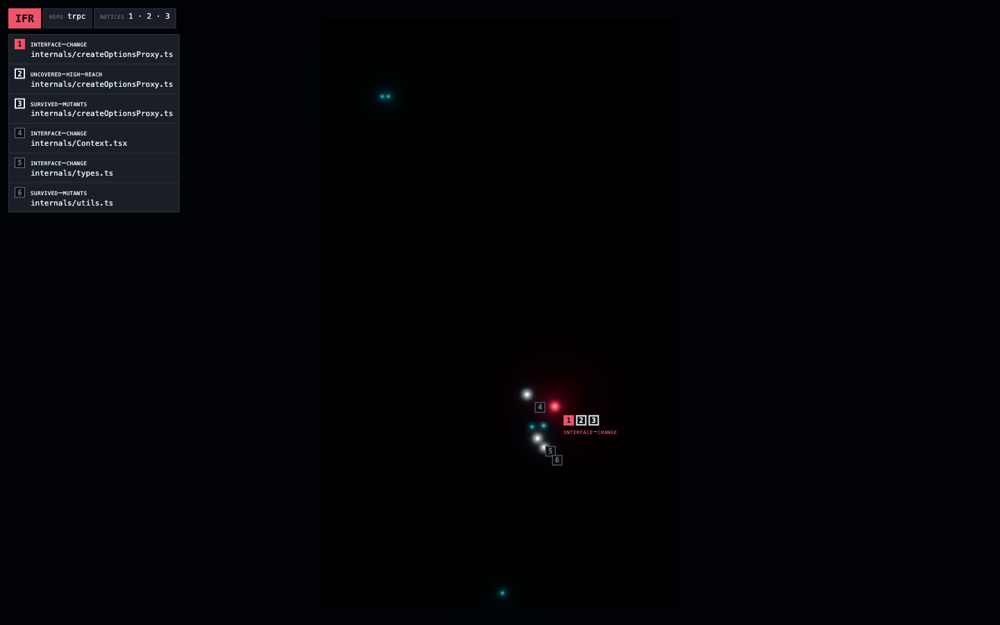

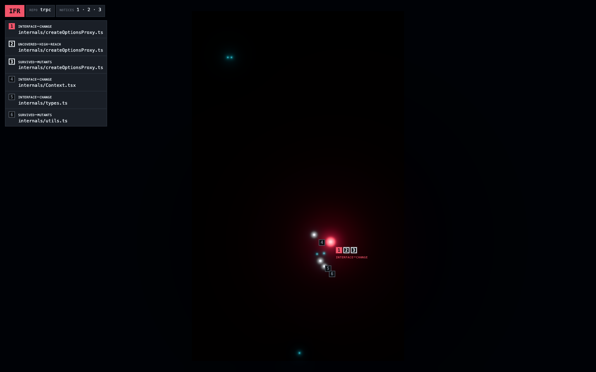

The ten-second frame is the one §5.6 wrote: a near-black field, the six notices
bright, and the rest of the changed set a dimmer scatter. It holds with the key
light and the sky fully off at this zoom, since either left on puts a specular
glint among the lights. At its peak the primary's flare spreads a wide red haze
through the bloom (the second frame); it was seen, and not patched.

### Closer (LOD1, the luminous surface): holds, with changes

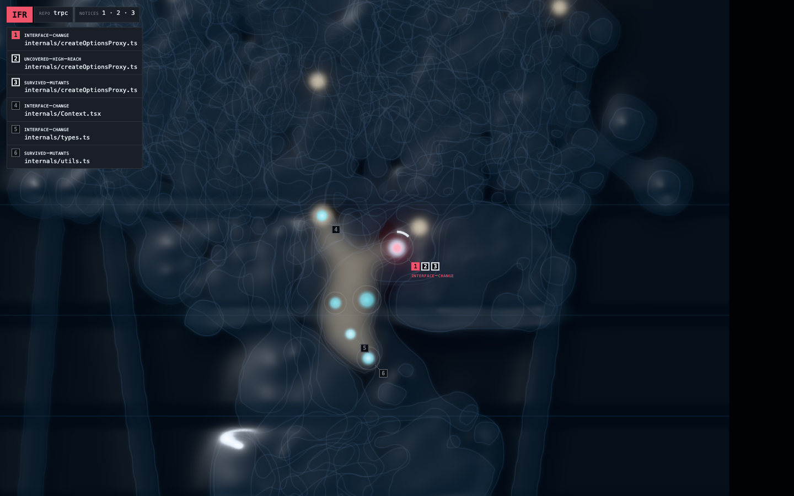

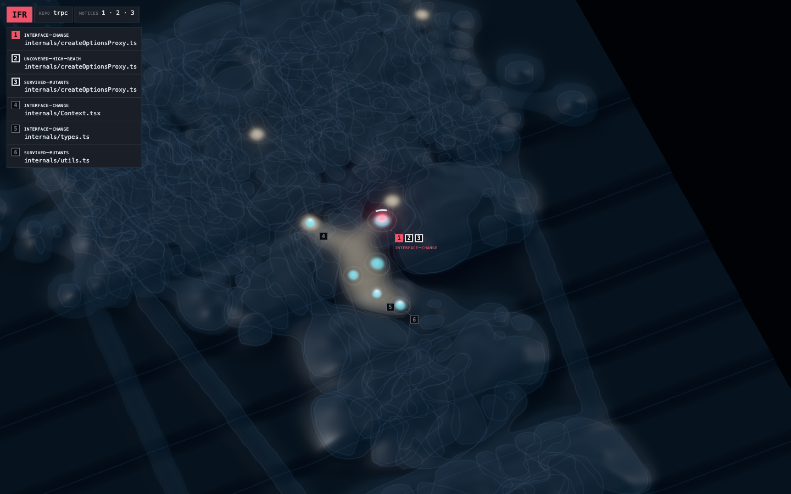

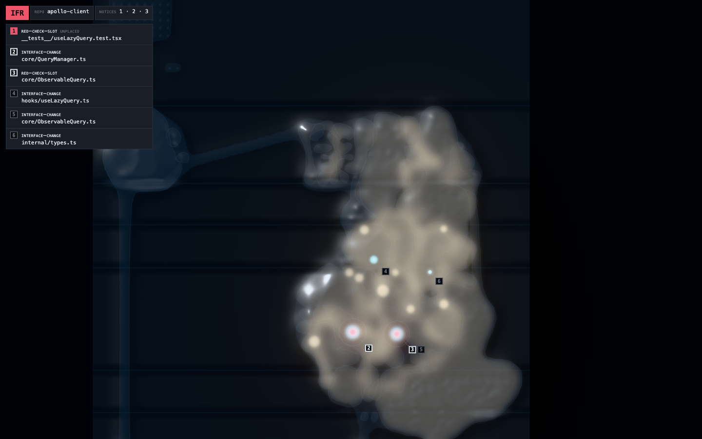

The surface resolves into tissue, and the reach flows through it: brightest in
the changed cells, dimmer at each membrane it crosses. It holds with five
changes, all made in a and judged there:

- **The reach is shaped by tissue, and barely blooms.** A broad reach feeds the
  bloom at a fifth of its light; at full weight, `retake-1`'s reach across 20
  cells read as fog rather than light. A container cell, a package holding
  folders, does not stack its glow on its children's: the brightest reach at
  each point wins, which keeps the decay per membrane (D5) legible. On
  `retake-1` most of `src` sits one hop out, so a wide warm region is the true
  picture.
- **No lines at the layers' edges, and softer terraces.** The straight lines
  read as noise. A layer's edge is now drawn from the terrace's slope at a
  strength that defaults to none, and each terrace is a 4-unit step eased over
  36, so the layers read as gentle relief alone.
- **The shore leaves the world.** The shore holds 584 of `retake-3`'s 1,063
  placed files, more than the terrain's 479, and drawn in the same wet tissue it
  read as malformed cells (the first frame below). It became flat, matte land,
  its files small marks and each group labelled with its kind and count (the
  second). At Rob's second look it left the world altogether, for a scrolled rail
  of brutalist blocks in the chrome (the frame of shapes, under Inside). There
  the groups the change touched come first and open on their files, the changed
  ones lit and named, and the rest stay collapsed. Without the shore, `retake-3`'s
  world frames about twice as large at the far zoom. The SVG keeps its shore
  (D48).
- **The sheen needs a sky to mirror.** A clearcoat gives the wet sheen, reading
  a normal of its own, and it reflects a sky made for it: black at the zenith, a
  band below about 60° of elevation, and three soft boxes. Flat tissue stays dark
  and the flanks of the bulges catch the light. Overhead the sheen is faint;
  tilted to 35°, it reads.
- **Stability swells wait for their data.** `map.json` carries no per-file age
  or churn, so §5.1's swells could not be drawn without faking them (C2). The
  relief is terraces and mass alone.

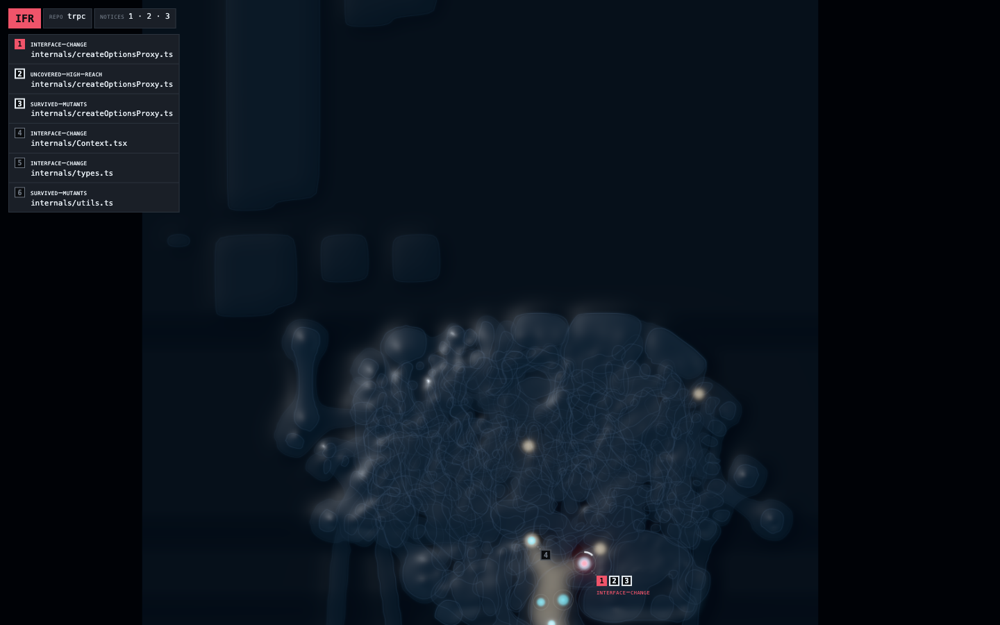

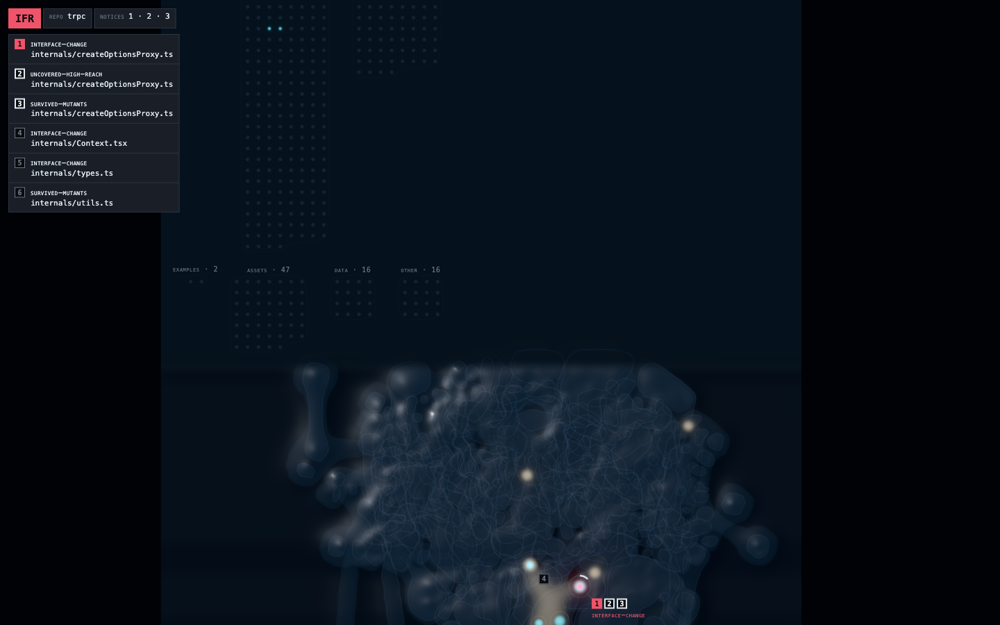

b at two of the same frames, for the comparison that settled it: base tissue a
brighter blue that competes with the weather, and a reach that dims inside the
thick bodies.

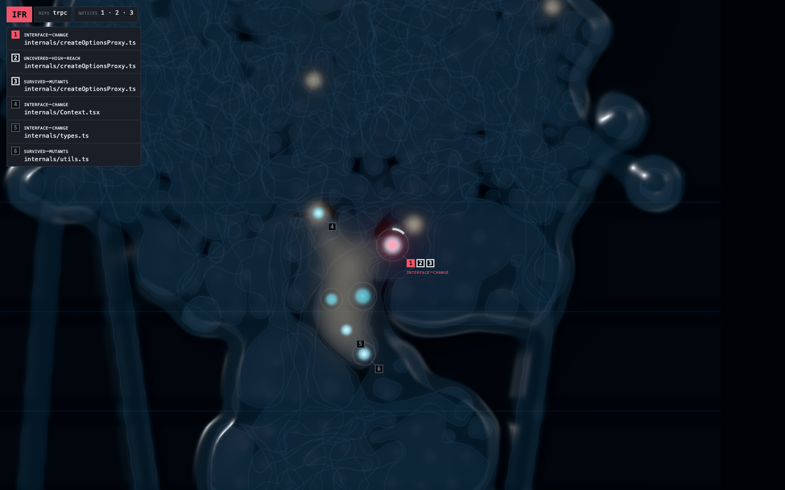

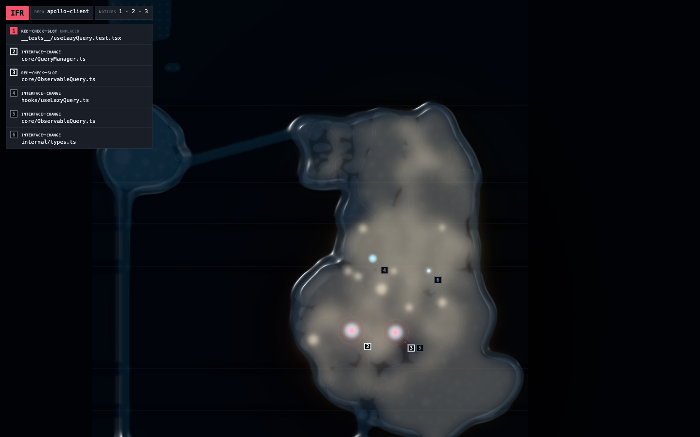

### Inside (LOD2, the stained cell): holds, with changes

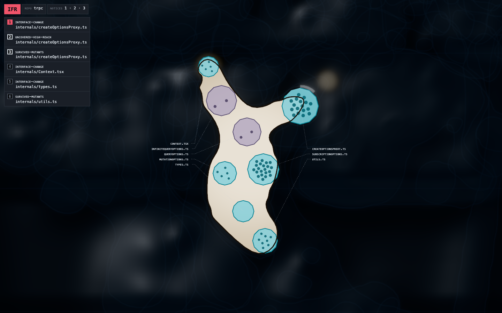

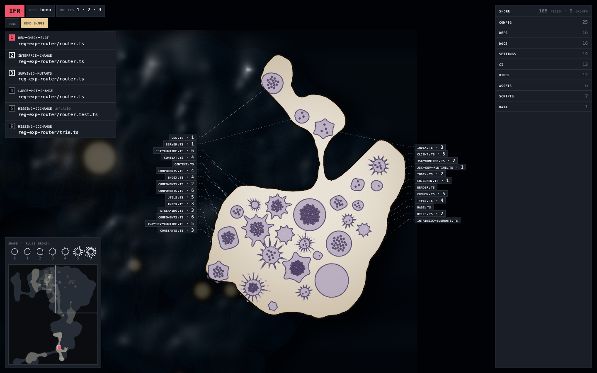

Zooming into a membrane fades in the interior as a stained slide: warm and
clinical where the surface was dark, the files stained bodies with their
functions as granules, and the labels on dotted leaders in the technical
drawing's manner. It holds, with two changes from Rob's second look built into a
(the second frame):

- **Shape is conformance, morphed.** A file's outline travels with the rules it
  breaks, 0 to 6: round, then a soft wobble, lobes, angular protuberances, and
  spiked arms with bulbs at their tips. The higher levels move inside an opened
  cell, faster and further as the level climbs, and nothing moves under reduced
  motion. No fixture file breaks 5 or 6, so the frame cycles every level, and
  its HUD says so.
- **A cell stays open while you move inside it.** It closes when you zoom out
  past it, click open ground or press Esc. Its file labels are tags on the
  chrome's ground, kept in columns on screen, each with its rule count.

Two gaps show, and both belong to other steps. Some files sit across their
cell's membrane, from the simplified ring the layout draws, plain in the first
frame. The granules are equal dots, since the map carries no function sizes yet.

### Motion: holds

At §5.5's starting numbers, measured as recorded under [Motion](#motion). Rob
made no balance patch.

### Open for the refine

The verdict leaves five rulings for the refine before wave 2:

- the shore rail, which amends D48 for the world while the SVG keeps its shore;
- the minimap, new chrome beside §7's HUD: the body's silhouette, how far the
  reach goes, the changed files, the notices and the view's outline, clicked or
  dragged to move;
- the morph, which replaces §5.1's one pulled vertex per rule, so the SVG would
  draw the same shapes still and the two renderers agree;
- the morph's motion, a second mover §5.5's budget does not allow: allow
  conformance motion inside an opened cell, where the reviewer chose to look, or
  keep shapes still;
- an unplaced primary: `retake-1`'s primary targets a test file the layout never
  placed, so the one notice that breathes has no light, in the world or the SVG.

## The world's budget

C14 holds the world to 60 fps at 5,000 files and to a first frame about 2 s after
the map arrives; the frame rates are held, and a first frame a little over 2 s
passes (D150). `apps/web/scripts/budget.ts` measures both on a seeded 5,000-file
map, `syntheticMap({ files: 5000, seed: 1 })` in `libs/scene/src/synthetic.ts`,
which core builds from a made-up repo of seventeen workspace packages: 5,006
placed files in 618 cells over seven terraces, a 59-file change, six notices and
an IFR category, 9.7 MB of `map.json`. The script builds the app as atis serves it,
serves the map beside it on loopback, and drives Chrome headed, since headless
Chrome has no WebGPU here and paces its frames by no display:

```sh
pnpm exec tsc --build && node apps/web/scripts/budget.ts
```

The first frame is the page's `atis:ready` mark, which the world sets once its
first complete frame is on the screen (the flag a capture waits on, D105), less
the moment the map's bytes arrived, its resource timing's `responseEnd`. The idle
reading is ten seconds of the settled opening frame; the sweep zooms in from the
far field a wheel step at a time until the canvas reaches LOD2 and the cell under
the centre opens. Each rate is read from the page's own animation frames.

Measured on 2026-10-24 on an Apple M1 Pro with 32 GB, macOS (Darwin 25.6.0),
Chrome 155 at 1,440 by 900 on the laptop's 120 Hz display:

| backend | first frame | idle, ten seconds | zoom sweep, LOD0 to LOD2 |
| --- | --- | --- | --- |
| WebGPU | 1.87 s | 120 fps; p95 frame 9.1 ms, worst 9.4 ms | 115 fps; p95 frame 9.1 ms; one frame over 16.7 ms, 42 ms, where the first cell opens |
| WebGL 2 | 1.92 s | 120 fps; p95 frame 9.0 ms, worst 9.4 ms | 114 fps; p95 frame 9.2 ms; one frame over 16.7 ms, 51 ms, where the first cell opens |

The first run drew its first frame in 13.4 s on WebGPU and 11.8 s on WebGL 2,
nearly all of it laying the reach and the base tissue into the skin's grids: the
scanline tested every edge of a contour against every row it spans, and a
membrane's contour carries hundreds of points. `scanRing` in
`libs/scene/src/raster.ts` now lays each edge into the rows it crosses, which
visits the same samples on every contour of the fixtures and of this map, 44
times faster.

Two things stand outside the table. The one long frame where the first cell
opens is not the slide's shader compile, since drawing the slide's materials
before the first frame left it at 34 to 42 ms; it is parked. And core takes
291 s to lay this map out, mostly in the membranes' outline routing: a cost the
CLI pays before the map arrives, outside the world's budget, and parked for wave
3's cache beside it.
