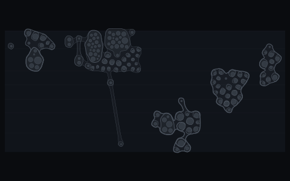

# The terrain fingerprint

`atis fingerprint` draws a repository's terrain alone, small, for a README:
the depth terraces, each cell's skin and the files on them, as the still map
draws its ground. It draws no weather, no notices, no overlay and no shore,
and it writes no text. It is a picture of the shape of the code, and of
nothing anyone asked about it.



```bash
atis fingerprint --out docs/img/fingerprint.svg
atis fingerprint --repo ../other --head v2.0.0 --out other.svg
```

The image is always 480 by 300, so it never changes the space it takes on a
page. It maps the whole repository at the head (`HEAD` unless `--head` names
another commit), measured afresh: the fingerprint neither reads nor writes
the terrain cache under `.atis/`, so one commit gives one layout and the same
bytes wherever it is drawn. The terrain only changes when the structure does,
which is the point. GitHub Next's repo-visualizer found that a picture of a
repository seen every day makes its structural change noticeable by
familiarity: a new package, a module that grew, a cell that split.

## Refreshing it every day

atis never installs a workflow. If you want the fingerprint kept fresh, this
GitHub Actions workflow redraws it once a day and commits it only when the
terrain moved. Save it as `.github/workflows/atis-fingerprint.yml` yourself.

```yaml
name: atis fingerprint

on:
  schedule:
    - cron: '17 6 * * *'
  workflow_dispatch:

permissions:
  contents: write

jobs:
  fingerprint:
    runs-on: ubuntu-latest
    steps:
      # The whole history: the terrain reads each file's age and churn from it.
      - uses: actions/checkout@v4
        with:
          fetch-depth: 0
      - uses: actions/setup-node@v4
        with:
          node-version: 22
      # If the repository runs fallow, install its dependencies first, so the
      # skins' dents and the clone glyphs are drawn as a local run draws them.
      - run: npx --yes @robmclarty/atis fingerprint --out docs/img/fingerprint.svg
      - name: Commit the fingerprint when the terrain moved
        run: |
          git add docs/img/fingerprint.svg
          if git diff --cached --quiet; then exit 0; fi
          git config user.name 'github-actions[bot]'
          git config user.email '41898282+github-actions[bot]@users.noreply.github.com'
          git commit -m 'docs: redraw the terrain fingerprint'
          git push
```

The workflow reaches the network only to install atis and to push the image
back. atis itself reads the checkout and writes one file.
